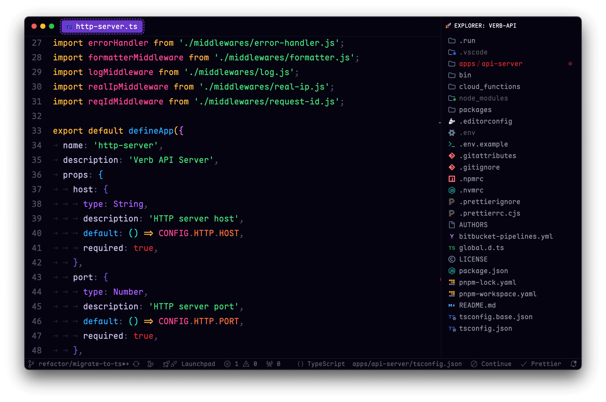

# 🚀 Minimalistic VS Code Config



# 📌 Description

This is my VS Code configuration for a clean and minimalistic interface. While it should work with other themes, full compatibility is not guaranteed.

# 🔧 Requirements

Ensure you have the following installed:

- [Custom UI Style+](https://marketplace.visualstudio.com/items?itemName=subframe7536.custom-ui-style) – for UI customization
- [Symbols Icons](https://marketplace.visualstudio.com/items?itemName=miguelsolorio.symbols) – for better file icons
- [PurpleSchool Theme](https://marketplace.visualstudio.com/items?itemName=PurpleSchool.purpleschool-theme) – my preferred theme
- [Maple Mono](https://github.com/subframe7536/maple-font) – recommended font

# 📥 Installation

1. Clone repo

```bash
cd ~/Documents
git clone https://github.com/men232/vscode-config.git
```

2. Copy the contents of [vscode-settings.json](vscode-settings.json) into your VS Code user settings.

```bash
cd ~/Library/Application\ Support/Code/User/

# Backup your config
cp ./settings.json ./settings.json.bk

# Overwrite with repo config
cp ~/Documents/vscode-config/vscode-settings.json ./settings.json
```

# 🎨 Customization

All tunable knobs are declared with defaults at the top of
[`vscode-styles.css`](vscode-styles.css) (the single source of truth). Override
any of them inside the `"body .monaco-workbench"` string in
`custom-ui-style.stylesheet` — that selector always wins over the defaults.

```
/* --- Surface / palette --- */
--al-transparency-percent: 0%;   /* raise only in transparent mode */
--al-pane-split-transparent: 6%; /* editor/pane split line opacity */

/* --- Tabs --- */
--al-tab-height: 38px;
--al-tab-y-offset: 7px;
--al-tab-fontSize: 14px;
--al-tab-borderRadius: 4px;
--al-tab-activeBackground: white;
--al-tab-activeColor: black;
--al-tab-label-shadow: 0px 2px 4px rgba(0, 0, 0, 0.15);
/* Active tab emphasis — dashed by default; try a solid line or a soft glow: */
--al-tab-active-outline: 1px solid var(--vscode-tab-activeBackground);
--al-tab-active-outline-offset: 2px;

/* --- Explorer / project title --- */
--al-project-icon: '🤯';           /* Default: 🚀 (used everywhere) */
--al-title-glow-color: cyan;       /* project-title-glow accent */
--al-title-glow-intensity: 1;      /* 0 = off … 1 = default */

/* --- Command palette --- */
--al-command-palette-blur-amount: 4px;
--al-command-palette-height: 35vh;
--al-command-palette-brightness: 70%; /* underlay dim; 100% = no dimming */

/* --- Focus glow --- */
--al-focus-glow-color: oklch(from var(--vscode-editor-background) 0.5 0.2 h);
--al-focus-glow-duration: 0.4s;
--al-focus-glow-blur: 1.5rem;
--al-focus-glow-scale: 0.03;
```

> **Accessibility:** the focus-glow animation is automatically disabled under
> `prefers-reduced-motion: reduce` (a calm static glow remains).

# Transparent mode

1. **Adds** this properties into user settings (json)

```json
{
  "custom-ui-style.electron": {
    "transparent": true,
    "backgroundColor": "rgba(0, 0, 0, 0)",
    "vibrancy": "fullscreen-ui"
  }
}
```

2. Increase transparency percent `--al-transparency-percent`

Complete example

```json
{
  "custom-ui-style.electron": {
    "frame": false,
    "transparent": true,
    "backgroundColor": "rgba(0, 0, 0, 0)",
    "titleBarStyle": "hiddenInset",
    "vibrancy": "fullscreen-ui",
    "trafficLightPosition": {
      "x": 15,
      "y": 14
    }
  },
  "custom-ui-style.stylesheet": {
    /**
     * Styles configuration
     */
    "body .monaco-workbench": "--al-transparency-percent: 10%; --al-tab-height: 38px; --al-tab-y-offset: 7px; --al-command-palette-blur-amount: 4px; --al-tab-fontSize: 14px;"
  }
}
```

# ⚙️ Disabling Specific UI Effects

Check the `custom-ui-style.external.imports`. You can comment out the CSS file related to a specific feature in your JSON configuration file.
For example, to disable the focus glow effect, simply comment out the import for `focus-glow.css`

# ⚠️ Known Issues

- Horizontal scrolling extends beyond the container, making it appear smaller than its actual size.

Let me know if you want to add possible workarounds or solutions! 🚀
